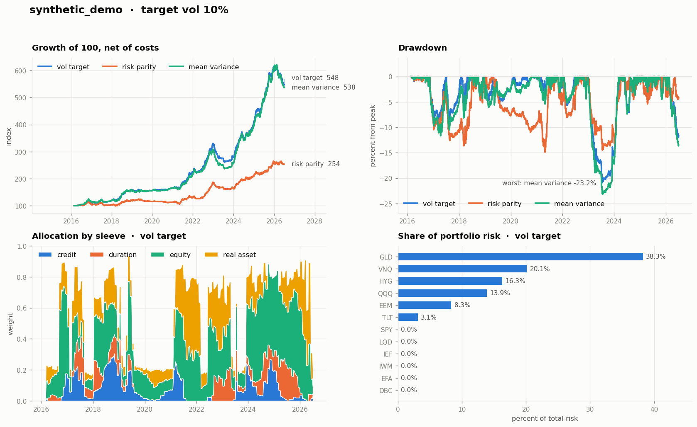

# portfolio-lab

A learning harness for the loop that actually matters:

```
signals  ->  covariance  ->  risk budget  ->  weights  ->  backtest  ->  attribution
```

Twelve liquid ETFs, three allocators that interpret "risk budget" three different
ways, and a backtest engine built so that lookahead bias is structurally
difficult rather than merely discouraged.

The point is not to find a strategy. The point is to see where each piece plugs
in, and to develop a feel for which pieces move the result and which do not.



## Quick start

```bash
pip install -e ".[dev,ingest]"

# No data needed - runs on synthetic prices with a planted factor structure
plab run --config configs/synthetic.yaml

# Real data (needs network access to the vendor)
plab ingest --start 2005-01-01
plab run --config configs/baseline.yaml

pytest
```

## The three readings of "risk budget"

All three take the same signals and the same covariance matrix, so any
difference in the result is attributable to the risk model alone.

| Allocator | Risk budget means | Needs return forecasts? |
|---|---|---|
| `vol_target` | one number for the whole portfolio: scale gross exposure until predicted vol hits the target | yes, for relative weights |
| `risk_parity` | a per-asset (or per-sleeve) share of total portfolio risk, equalised | **no** |
| `mean_variance` | a variance cap: maximise `w'μ` subject to `w'Σw ≤ σ²` | yes, heavily |

Run all three and compare turnover. Mean-variance will trade the most and
concentrate the hardest, because a linear objective against a noisy `μ` is an
error-maximiser. That is the lesson, not a bug.

## Layout

```
src/portfolio_lab/
├── data/        universe, append-only snapshot store, ingestion, synthetic generator
├── signals/     Signal ABC, 12-1 time-series momentum, cross-sectional momentum, regime overlay
├── risk/        sample / EWMA / Ledoit-Wolf covariance, risk contributions
├── allocate/    Allocator ABC + RiskBudget, and the three implementations
├── backtest/    walk-forward engine, linear cost model, metrics
└── report/      validated chart palette, comparison tearsheet
```

## Design decisions worth knowing about

**Signals produce views, not weights.** A signal says "I like this asset"; the
allocator decides what that is worth given the covariance and the budget.
Keeping that boundary clean is what lets you swap either side independently.

**Weights are applied one day late.** A decision made using data through `t`
earns the return from `t` to `t+1`. `tests/test_no_lookahead.py` enforces this
two ways: signals must be causal under truncation, and scrambling returns after
a cutoff must not change a single backtest return before it.

**Weights drift between rebalances.** A "monthly" backtest that quietly
rebalances daily understates turnover and manufactures a rebalancing bonus.

**Storage is append-only snapshots.** Each ingestion run writes
`prices_captured=YYYY-MM-DD.parquet`. Vendors restate history, and you cannot
reconstruct after the fact what the data looked like on a past date.
`store.load_prices(as_of=date(...))` replays the point-in-time view. This costs
kilobytes now and is impossible to backfill later.

**Synthetic data with a planted answer.** `data/synthetic.py` generates returns
from a known factor structure plus an AR(1) drift. Tests assert the covariance
estimators recover the planted values and that shrinkage beats the sample
estimator in small samples. On real data you cannot distinguish skill from luck
from a bug; here you can.

**No database server.** Twelve ETFs of daily history is a few hundred kilobytes.
Parquet on disk with DuckDB as the query layer, all behind `PriceStore`, so
swapping in Postgres later is one new class rather than a refactor.

## Things to try

1. Set `risk.cov_method: sample` and watch mean-variance concentration get worse.
2. Set `regime.enabled: false` — how much of the drawdown reduction was the overlay?
3. Push `backtest.cost_bps` to 25 and see which allocator dies first.
4. Change `backtest.rebalance` to `weekly`. Does the extra responsiveness pay for the turnover?
5. Add `budget.sleeve_budgets` and give `risk_parity` an explicit per-sleeve risk split.

## Caveats

This is a teaching harness, not a trading system. It has no slippage or market
impact model, no borrow costs or financing, no dividend/tax treatment beyond
whatever the vendor's adjusted prices assume, no survivorship-bias handling (the
ETF sleeve is hardcoded and current), and a single in-sample pass with no
walk-forward parameter selection. Every one of those is a good next exercise.
